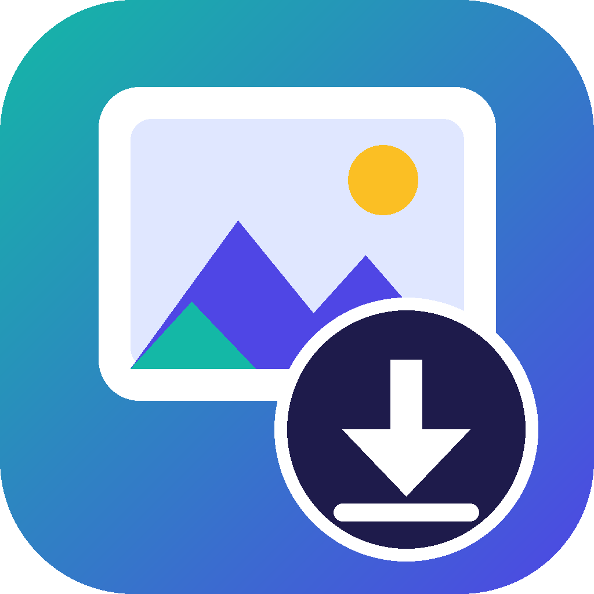

<p align="center">
  
</p>

<h1 align="center">Gemini Image Downloader</h1>

<p align="center">
Download all the images in your Gemini <b>Library</b> to your PC in one go, with no need to open every chat.
</p>

> **Unofficial tool, not affiliated with or endorsed by Google.** It works by reading the Gemini
> web page, so it may stop working if Google changes the site. Use it only on your own account
> and at your own risk. Automating a website may be against its terms of service; check them
> if that matters to you.

## Features

- Saves your Gemini Library images in full size into a single folder
- Runs **100% locally**: you sign in to your own Google account in a normal browser window, and nothing is uploaded anywhere
- Uses your installed **Google Chrome or Microsoft Edge**, no extra browser download
- **Safe to re-run**: recognises pictures you already have (even ones saved by older versions, under other names, or with different file metadata) and only saves new ones
- **New pictures only** mode: after one full scan, later runs check just the newest part of your Library and finish in a few minutes
- Time-stamped progress log, a running timer, an estimate of time left and a time-taken summary when it finishes
- A clean, modern window with **light and dark modes** (follows Windows by default, or pick Light/Dark), a progress bar, a Stop button and a choice of save folder
- Friendly messages if something goes wrong
- Windows `.exe` available, no Python needed

## Download and use (Windows)

1. Download `GeminiImageDownloader.exe` from the [**Releases**](../../releases) page.
2. Put it in its own folder (for example `C:\GeminiDownloader`) and double-click it.
3. If Windows shows **"Windows protected your PC"**, click **More info → Run anyway**.
   The exe isn't code-signed, so Windows warns about it. You can check the file against the
   `.sha256` file on the release page, or [build it yourself](#build-from-source).
4. In the window, choose where to save your images (or keep the default `gemini_images` folder
   next to the program) and click **Start**.
5. A browser window opens on Gemini. Sign in if asked and wait until your chats are visible,
   then click **Continue** in the yellow box in the tool's window.
6. Wait while it scrolls through your Library and saves the images (large libraries can take
   several minutes). Don't close the browser window, and keep it visible (not minimised or hidden behind other windows) while it loads. You can click **Stop** at any time.
7. When it finishes, the folder with your images opens.

**Already have images?** Pick the folder that holds them as the save folder. The tool recognises
pictures it (or an older version) already saved by comparing the pictures themselves, so copies
are skipped even if the files differ in hidden metadata. The first run with a big folder takes a
few minutes to check what's there; the result is remembered in a hidden `.gemini_index.json`
file in that folder.

Every message in the log shows the time it happened, a timer at the top right counts the elapsed time, and the final summary shows how long each part took. A copy of the log is saved as `last_run_log.txt` next to the program (use the **Open log** button); it's handy to attach to a bug report.

Use the **Auto / Light / Dark** switch at the top right to change the look; it remembers your choice.

Run it again any time to pick up new images. To sign out, delete the `browser_profile` folder
next to the program.

**Requirements:** Windows 10/11 and Google Chrome or Microsoft Edge (Edge comes with Windows).

## Scan modes

- **New pictures only (faster)** is ticked by default. Gemini lists new pictures first, so the tool looks at the
  newest part of your Library and stops once it reaches pictures you already have. It usually takes a few
  minutes instead of about 15.
  - The first runs are full scans. The first full scan records the order of your Library; the next full scan that
    finds new pictures confirms they appear at the top. After that, new-pictures-only runs are used.
  - A **full scan is still done at least every 7 days**, and automatically if the order of your Library no longer
    matches what the tool recorded. Untick the box any time for a complete scan.
  - If new pictures ever turn out *not* to be listed first, the tool switches the mode off and says so.
- **Quick listing (experimental)** is unticked by default and only affects full scans. It jumps straight to the
  bottom of the Library to load everything at once. In testing it was no faster than the normal scan and
  sometimes stopped short, so a few pictures could be missed. Hover over the **?** next to each option in the
  window to see this note.

From the command line: `--full` turns new-pictures-only off, and `--quick-listing` turns the quick listing on.

## Privacy

- It talks only to Gemini and Google's image servers, using your own login.
- It writes only to the folder you choose for your images (`gemini_images/` next to the program by
  default) and to its own `browser_profile/` folder next to the program (its saved login, separate
  from your everyday browser profile), plus `last_run_log.txt` (a copy of the latest log, with your folder path and counts but no private image links) and a tiny `settings.json` that remembers your theme and folder choice. Only if something goes wrong it also writes `error_log.txt`
  or `no_images_found.png` there.
- It doesn't read or change anything else on your computer, and it never touches your normal
  Chrome or Edge profile, passwords, history or bookmarks.
- **Never share your `browser_profile` folder.** It contains your Google login session.

## Troubleshooting

| Problem | What to do |
|---|---|
| "Couldn't find Google Chrome or Microsoft Edge" | Install [Google Chrome](https://www.google.com/chrome) and run again. |
| It can't find "Library" | Click **Library** yourself in the browser window, then press Enter in the console. |
| "No images were found" | Your Library may be empty, or Gemini changed its layout. A screenshot (`no_images_found.png`) is saved next to the program; please [open an issue](../../issues) with it (blank out anything personal). |
| Antivirus blocks or removes the exe | A known false positive with PyInstaller programs. Add an exception, or [build it yourself](#build-from-source). |
| Some images failed | Run it again; it retries only the missing ones. |
| Anything else | Check `error_log.txt` next to the program and [open an issue](../../issues) with its contents. |

Another option from Google: [Google Takeout](https://takeout.google.com) can export some
Gemini data without any tools. What it includes has varied over time.

## Run from source

```powershell
git clone https://github.com/ADPCCustoms/gemini-image-downloader.git
cd gemini-image-downloader
python -m pip install -r requirements.txt
python gemini_image_downloader.py
```

This opens the window. Add `--cli` to run in the console instead, and `--debug` for
extra diagnostic output (when running from source).

## Build from source

Requires Windows and Python 3.10+.

```powershell
build.bat
```

The program is created at `dist\GeminiImageDownloader.exe`. To use a different icon, replace
`icon.ico` before building.

The exe is built as a windowed app (no console). Releases are built automatically by GitHub Actions: pushing a tag such as `v1.0.0` builds the
exe and attaches it, with a SHA-256 checksum, to a GitHub release.

## Cleaning up duplicates

If a folder already has repeat copies from several runs, `tools/find_duplicates.py` finds pictures
that a later run saved again and moves them into a `_duplicates` sub-folder (it never deletes
anything). It needs Pillow: `python -m pip install pillow`. Run it without `--move` first to see
a report.

## How it works

The tool uses [Playwright](https://playwright.dev/python/) to drive your installed browser. It
opens Gemini, clicks **Library**, scrolls until everything has loaded, collects the image
URLs, and downloads each one at full size. It's an interface-level tool, not an official API,
which is why it can break when the page layout changes. Fixes and improvements are welcome.

## Contributing

Issues and pull requests are welcome, especially fixes for layout changes on Gemini's side.
When reporting a problem, include the Windows version, which browser was used, and the
text the tool printed. Remove anything personal first.

## License

[MIT](LICENSE)
